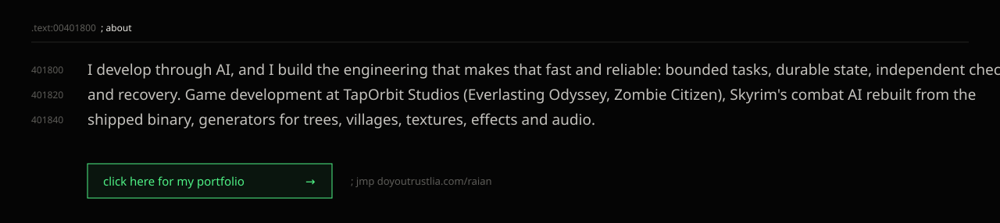

<a href="https://doyoutrustlia.com/raian/"><picture><source media="(prefers-color-scheme: light)" srcset="assets/header-light.svg"></picture></a>

<a href="https://doyoutrustlia.com/raian/"><picture><source media="(prefers-color-scheme: light)" srcset="assets/about-light.svg"></picture></a>

<picture><source media="(prefers-color-scheme: light)" srcset="assets/contributions-light.svg"></picture>

<picture><source media="(prefers-color-scheme: light)" srcset="assets/divider-work-light.svg"></picture>

<a href="https://github.com/DITlieD/polyspoon"><picture><source media="(prefers-color-scheme: light)" srcset="assets/card-polyspoon-light.svg"></picture></a>
<a href="https://github.com/DITlieD/StillWrong"><picture><source media="(prefers-color-scheme: light)" srcset="assets/card-stillwrong-light.svg"></picture></a>

<a href="https://github.com/DITlieD/neuron-soul"><picture><source media="(prefers-color-scheme: light)" srcset="assets/card-neuron-soul-light.svg"></picture></a>
<a href="https://github.com/DITlieD/ELAI-archive"><picture><source media="(prefers-color-scheme: light)" srcset="assets/card-elai-light.svg"></picture></a>

<a href="https://github.com/DITlieD/lia-trust"><picture><source media="(prefers-color-scheme: light)" srcset="assets/card-lia-trust-light.svg"></picture></a>
<a href="https://github.com/DITlieD/understudy"><picture><source media="(prefers-color-scheme: light)" srcset="assets/card-understudy-light.svg"></picture></a>

