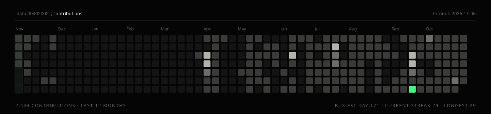
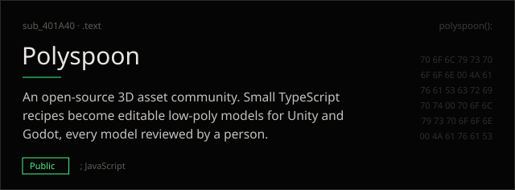
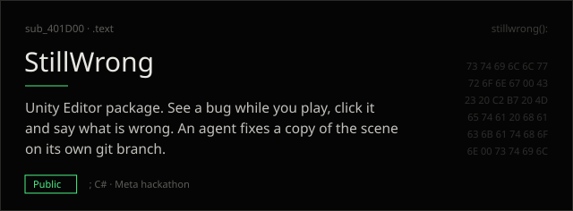
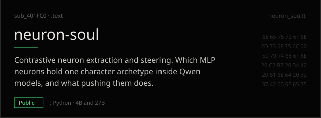
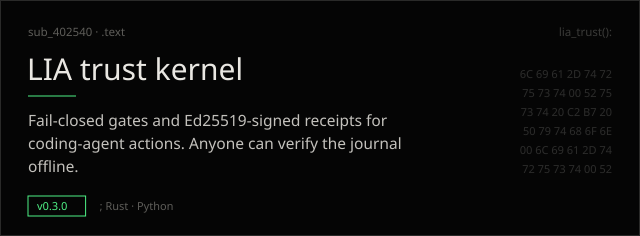
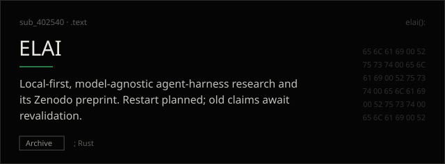
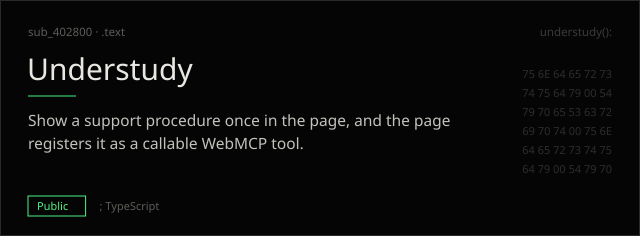

<a href="https://doyoutrustlia.com/raian/"><picture><source media="(prefers-color-scheme: light)" srcset="assets/header-light.svg"></picture></a>

I develop through AI, and I build the engineering that makes that fast and reliable: bounded tasks, durable state, independent checks and recovery. Game development at TapOrbit Studios (Everlasting Odyssey, Zombie Citizen), Skyrim's combat AI rebuilt from the shipped binary, generators for trees, villages, textures, effects and audio.

Portfolio: **[doyoutrustlia.com/raian](https://doyoutrustlia.com/raian/)**

<picture><source media="(prefers-color-scheme: light)" srcset="assets/contributions-light.svg"></picture>

<picture><source media="(prefers-color-scheme: light)" srcset="assets/divider-work-light.svg"></picture>

<a href="https://github.com/DITlieD/polyspoon"><picture><source media="(prefers-color-scheme: light)" srcset="assets/card-polyspoon-light.svg"></picture></a>
<a href="https://github.com/DITlieD/StillWrong"><picture><source media="(prefers-color-scheme: light)" srcset="assets/card-stillwrong-light.svg"></picture></a>

<a href="https://github.com/DITlieD/neuron-soul"><picture><source media="(prefers-color-scheme: light)" srcset="assets/card-neuron-soul-light.svg"></picture></a>
<a href="https://github.com/DITlieD/lia-trust"><picture><source media="(prefers-color-scheme: light)" srcset="assets/card-lia-trust-light.svg"></picture></a>

<a href="https://github.com/DITlieD/ELAI-archive"><picture><source media="(prefers-color-scheme: light)" srcset="assets/card-elai-light.svg"></picture></a>
<a href="https://github.com/DITlieD/understudy"><picture><source media="(prefers-color-scheme: light)" srcset="assets/card-understudy-light.svg"></picture></a>

<picture><source media="(prefers-color-scheme: light)" srcset="assets/divider-record-light.svg"></picture>

- **Sep 2026** · coverage.py [#2301](https://github.com/coveragepy/coveragepy/pull/2301) merged, false branch coverage on Python 3.14 · [#2307](https://github.com/coveragepy/coveragepy/pull/2307) open
- **Sep 2026** · Omi [#13050](https://github.com/BasedHardware/omi/pull/13050) merged, PCM16 codec in the Rust SDK
- **2026** · GPU from Unity's 6.6 Beta Sweepstakes, for editor bug reports
- **Jul 2026** · [LIA trust kernel v0.3.0](https://github.com/DITlieD/lia-trust/releases/tag/v0.3.0)
- **2025** · [ELAI: Toward Ontological Artificial Intelligence](https://doi.org/10.5281/zenodo.17928154), preprint on Zenodo

[notditlied@gmail.com](mailto:notditlied@gmail.com) · [LinkedIn](https://www.linkedin.com/in/dytl/) · Discord `dytlia`
